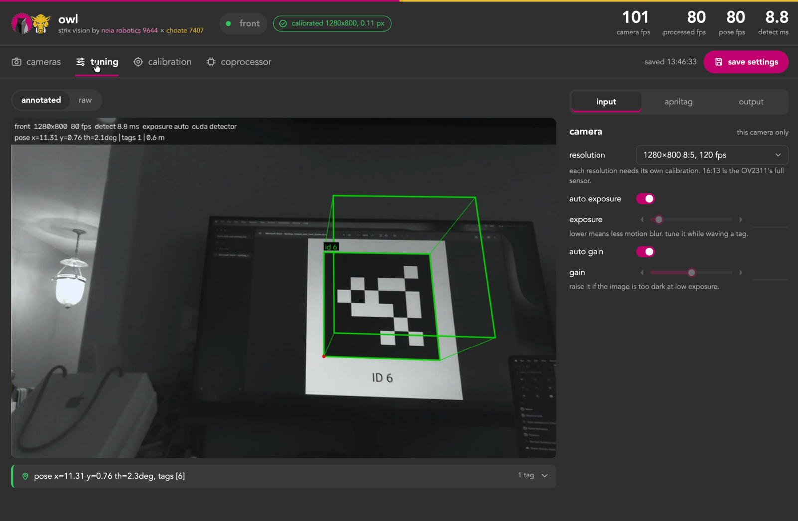

# Strix

Strix is an AprilTag vision system for FRC, shared by NEIA Robotics (9644) and Choate (7407). It has two halves, named after the two schools' mascots:

- Owl (`owl/`) runs on the coprocessor. It captures from every camera, finds AprilTags, solves the robot's pose and publishes all cameras' results as one NetworkTables topic. It has a PhotonVision-style web page for streams, settings and calibration.
- Tusk (`tusk/`) runs on the robot. It reads that topic once per loop, picks the right pose for single-tag frames, sets std devs and feeds the pose estimator. It comes in RobotPy (`tusk/robotpy`) and Java (`tusk/java`) versions with the same classes.

`native/gpu_detector/` is an optional CUDA tag detector (FRC 971's, via Team 766) that lets Owl find tags on a Jetson's GPU. It falls back to the CPU if the GPU path fails.

Both halves work with WPILib 2026 and 2027. See [docs/wpilib-2027.md](docs/wpilib-2027.md) for what changed and what's been tested.

```
cameras ──► Owl (Orange Pi / Jetson) ──NT4: /Vision/observations──► Tusk (roboRIO / Systemcore) ──► pose estimator
```



## Quick start

### Coprocessor (Owl)

Full setup, calibration and tuning are in [owl/README.md](owl/README.md).

```bash
cd owl
pip install -r requirements.txt
python test_synthetic.py                      # pose math check, no camera needed
cp config.example.json config.json            # then edit cameras and robot_to_camera
python main.py --config config.json --standalone
```

### Robot, RobotPy

Copy `tusk/robotpy/tusk/` into the robot project, then:

```python
from tusk import TuskVision

self.vision = TuskVision()
# in periodic():
self.vision.update(self.pose_estimator)
```

### Robot, Java

Build the jar for your season, or export plain sources to copy in:

```bash
cd tusk/java
./gradlew build -PwpilibYear=2026          # build/libs/strix-tusk-2026-*.jar
./gradlew exportSources -PwpilibYear=2026  # build/export/tusk-src-2026/
```

```java
TuskVision vision = new TuskVision();
// in periodic():
vision.update(poseEstimator); // uses sampleAt(captureTime) for delayed frames
```

For the AdvantageKit vision template (NEIA's robot code), see [tusk/java/examples/VisionIOTusk.java](tusk/java/examples/VisionIOTusk.java).

## Repository layout

| Path | What |
| --- | --- |
| `owl/` | Coprocessor app (Python, RobotPy 2026 libraries) |
| `owl/configs/` | Tuned configs per robot (`7407.json` is Choate's) |
| `tusk/robotpy/` | Robot side for RobotPy, plus tests and a 7407 example |
| `tusk/java/` | Robot side for Java, built for 2026 or 2027 |
| `tusk/testdata/` | Struct bytes both Tusk versions are tested against |
| `native/gpu_detector/` | Optional CUDA detector and its C API (untested on Jetson so far) |
| `deploy/` | systemd unit for Owl |
| `tests/` | Cross-season NetworkTables check |
| `docs/` | [Architecture](docs/architecture.md), [WPILib 2027](docs/wpilib-2027.md), [roadmap](docs/roadmap.md) |

## Testing

CI runs everything below on every push. To run it locally:

```bash
(cd owl && python test_synthetic.py)
python -m pytest -q tusk/robotpy/tests                  # in a RobotPy 2026 and a 2027 env
(cd tusk/java && ./gradlew build -PwpilibYear=2027 && ./gradlew build -PwpilibYear=2026)
(cd native/gpu_detector && cmake -S capi -B build-cpu -DATGPU_BACKEND=cpu \
   && cmake --build build-cpu && ctest --test-dir build-cpu)
```

## Status

Owl runs on Choate's Orange Pi 5 with two OV2311 cameras. It started as Choate's camtest; this repo merges its `jetson` and `biggie` (pre-CKI) branches. Tusk passes its tests on both WPILib seasons, but nothing has run on a Systemcore yet. The GPU detector compiles for the Jetson's GPU (sm_87) in CI and has passed every check on two NVIDIA GPUs: a T4 on x86 (Colab) and a T4G on ARM64 (AWS `g5g.xlarge`, Ubuntu 22.04), matching WPILib's detector to within 0.013 px on the test images. For the GPU detector, a real Jetson is the only platform left. The first Jetson run is next on the [roadmap](docs/roadmap.md).

## Credits and license

MIT; see [LICENSE](LICENSE). The GPU detector is FRC 971's code (Apache-2.0), packaged by Team 766, with a C API from Choate. Several ideas come from FRC 6328's Northstar. Details are in [NOTICE.md](NOTICE.md).
