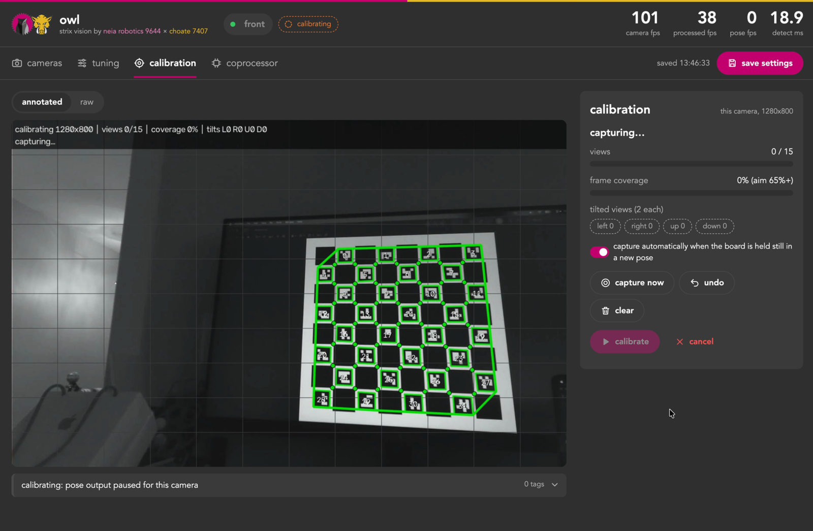
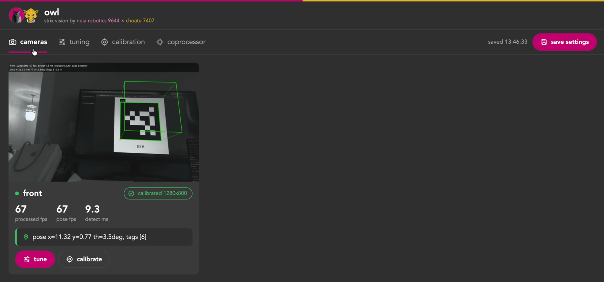
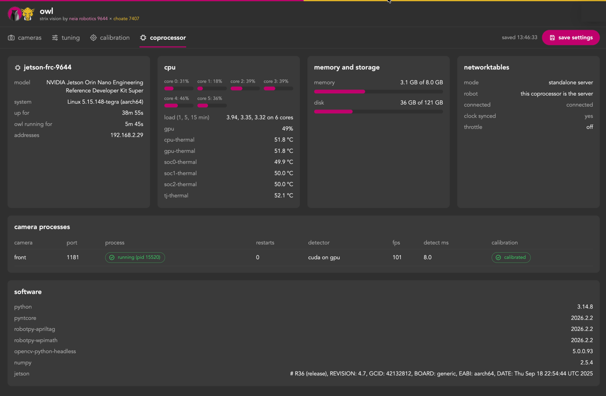

# Owl: the Strix coprocessor app

Owl runs on the coprocessor (Orange Pi 5 today, Jetson next). One process per camera does capture → AprilTag detection → pose solve → std devs. All cameras publish into **one** NT4 struct-array topic, so the robot does a single NT read per loop and loops `addVisionMeasurement()`. The robot side of that is Tusk (`../tusk`).

Everything is run from one web page, like PhotonVision: live stream, settings, resolution and camera calibration for every camera, with a camera dropdown at the top. Settings are also live-tunable over NetworkTables.

Adding a camera is just adding an entry to `config.json`. Nothing else changes on either side.

```
owl/                      -> goes on the coprocessor
  main.py                 spawns camera processes, publishes the batched topic
  camera_process.py       per-camera capture/detect/solve (own process = own CPU core)
  pose_solver.py          multi-tag SQPNP / single-tag IPPE, filters, std dev factor
  cuda_detector.py        optional GPU tag detection on a Jetson (falls back to the CPU detector)
  config.py               config + calibration loading (accepts PhotonVision exports)
  settings.py             live settings (NT + web page) and save-to-config.json
  stream_server.py        per-camera web server: MJPEG streams + settings/calibration API
  web_ui.html             the settings page (stream, settings, resolution, calibration)
  calibration_session.py  in-browser ChArUco calibration
  camera_controls.py      exposure/gain/resolution modes (v4l2-ctl on Linux, OpenCV fallback)
  vision_types.py         the NT4 struct (identical to tusk/robotpy/tusk/vision_types.py)
  test_synthetic.py       renders tags from known poses and checks the math
  list_cameras.py         finds cameras, saves a snapshot from each
  calibrate.py            ChArUco calibration from a terminal (alternative to the page)
  config.example.json     start here: cp config.example.json config.json
  configs/7407.json       Choate's tuned config (copy to config.json on their Pi)
  calibrations/           <camera>_<W>x<H>.json, one per camera per resolution (not in git)
../deploy/owl.service     systemd unit (run on boot)
../tusk/                  -> goes in your robot project (RobotPy or Java)
```

Owl uses RobotPy 2026 libraries even when the robot runs WPILib 2027; see `../docs/wpilib-2027.md`.

## Quick reference (Choate's Orange Pi)

Choate's setup: Pi at **192.168.50.2**, user **choate7407**, code in `~/vision/coprocessor`, run by the `vision` systemd service. Commands below run on your Mac from the repo root.

| What | How |
|---|---|
| Settings page (all cameras) | `http://192.168.50.2:1181/` (camera dropdown at the top) |
| AdvantageScope / Elastic | connect to `192.168.50.2` (run `main.py --standalone` when there's no roboRIO) |
| Is it running? | `ssh choate7407@192.168.50.2 "systemctl status vision --no-pager"` |
| Logs | `ssh choate7407@192.168.50.2 "journalctl -u vision -n 50 --no-pager"` (`-f` to follow) |
| Restart | `ssh -t choate7407@192.168.50.2 "sudo systemctl restart vision"` |
| Deploy code | `scp owl/*.py owl/web_ui.html choate7407@192.168.50.2:~/vision/coprocessor/` then restart |
| Pull tuned config back | `scp choate7407@192.168.50.2:~/vision/coprocessor/config.json owl/configs/7407.json` |
| Back up calibrations | `scp -r choate7407@192.168.50.2:~/vision/coprocessor/calibrations owl/` |

Don't `scp` your `config.json` *to* the Pi without pulling it first: settings saved on the Pi (exposure, resolution, filters) live only in the Pi's copy. Tip: `ssh-copy-id choate7407@192.168.50.2` once, and you stop typing the SSH password.

## What's been verified

- **Pose math** (`test_synthetic.py`): renders real tag36h11 images on the 2026 field from known robot poses through a pitched/yawed/offset camera. Median error 0.3 cm multi-tag, 0.7 cm single-tag.
- **End to end** in a sandbox: two synthetic camera feeds → `main.py` → NT4 → `batched_vision.py` → `SwerveDrive4PoseEstimator` started 1.8 m off converged to 1.8 cm of truth.
- **Calibration**: a simulated OV2311 at 1600×1300 with strong barrel distortion, calibrated through the web flow (auto-capture from a video), recovered fx/fy/cx/cy within ~0.5 px of truth at 0.28 px RMS.
- **Live settings / page**: changes from the page, Elastic and AdvantageScope stay in sync; save writes config atomically; resolution switching loads the matching calibration.
- **On the Orange Pi 5**: runs as a service with two USB cameras, streams and settings page work, exposure/gain via `v4l2-ctl`.

Two things found along the way that are worth knowing even if you never use this code. First, WPILib's `AprilTagDetector` defaults `minClusterPixels` to 300, which silently drops small or far tags once `quadDecimate` is 2; 20 found more tags than no decimation at about a third of the CPU. Second, OpenCV's generated tag36h11 images are rotated 180° from the official FRC tags, so don't print test tags from `cv2.aruco`; use the official AprilRobotics images.

## Developing on a Mac

Everything runs on macOS, and it's the easiest way to iterate: robot code in RobotPy simulation, the vision code, and AdvantageScope all on one machine.

```bash
cd owl
pip3 install -r requirements.txt
python3 test_synthetic.py          # should print PASS
python3 list_cameras.py            # which index is which camera (saves snapshots)
```

The first time you open a camera, macOS asks for camera permission for whatever app launched Python (Terminal, iTerm, VS Code). If `list_cameras.py` finds nothing, check System Settings > Privacy & Security > Camera.

On a Mac, use camera **indices** in `config.json` (`"device": 0`), not `/dev/...` paths. The order can change when you replug cameras, and the built-in camera or a nearby iPhone (Continuity Camera) may take index 0. Manual exposure and resolution lists are Linux-only; on macOS cameras run on auto exposure. A video file also works as a `device` (add `"loop_video": true`), which is handy for testing the page and calibration without a camera.

```bash
# Vision only: this process is the NT server. Point AdvantageScope at localhost.
python3 main.py --config config.json --standalone

# Full loop: start your robot code in sim first (it becomes the NT server)...
python -m robotpy sim
# ...then in another terminal, connect vision to it:
python3 main.py --config config.json --server 127.0.0.1
```

Judge frame rate and `processMs` on the Pi, not the Mac; Apple Silicon is much faster.

## 1. Set up the Orange Pi

Use a **second** SD card so the competition PhotonVision card stays untouched. We run Ubuntu 22.04 (the Orange Pi image) with Python 3.14 in a venv at `~/vision/coprocessor/venv`.

Owl needs Python **3.11 or newer** on ARM64; Ubuntu 22.04's default Python 3.10 has no wheel for the pinned RobotPy AprilTag package. The requirements select an exact NumPy version for the Python release, including Python 3.14. See the [published wheels](https://pypi.org/project/robotpy-apriltag/2026.2.2/#files).

The Pi usually has **no internet**, so install from wheels downloaded on a Mac. `owl/wheels/` (not in git) holds the aarch64 / cp314 wheels for everything in `requirements.txt`:

```bash
# On the Pi, in ~/vision/coprocessor:
<your python3.14> -m venv venv
venv/bin/pip install --no-index --find-links wheels -r requirements.txt
venv/bin/python test_synthetic.py          # should print PASS
```

**v4l2-ctl** is needed for manual exposure/gain and for the resolution list. With internet it's `sudo apt install v4l-utils`, but on the Orange Pi image that package conflicts with the Rockchip-patched `libv4l-0` (`...+rkmpp`), and downgrading that library can break hardware video decoding. Instead, extract just the binary from Ubuntu 22.04's arm64 `v4l-utils` .deb on the Mac and install it:

```bash
scp v4l2-ctl choate7407@192.168.50.2:~/
ssh -t choate7407@192.168.50.2 "sudo install -m 755 ~/v4l2-ctl /usr/local/bin/ && v4l2-ctl --version"
```

It only needs `libv4l2.so.0`, which the patched library provides.

**Network.** Give the Pi a static IP (ours is 192.168.50.2). To work on it over a direct Ethernet cable, set your Mac's Ethernet adapter to a manual address on the same subnet (e.g. 192.168.50.10, mask 255.255.255.0, no router) and check with `ping 192.168.50.2`.

## 2. Cameras

```bash
ls -l /dev/v4l/by-path/
v4l2-ctl -d /dev/video0 --list-formats-ext    # resolutions/fps per format
```

Use the `/dev/v4l/by-path/...-video-index0` paths in `config.json` (each camera also shows an `index1`; that's metadata, ignore it). By-path names are tied to the physical USB port, so identical cameras can't swap between reboots. Moving a cable to another port does change them.

**Resolution.** Pick it on the settings page; the dropdown lists what the camera offers in MJPG, with 16:13 (the OV2311's full 1600×1300 sensor) first when it's available. If it isn't, use **1600×1200** (4:3, nearly the full sensor). Avoid 16:9 modes: they crop the vertical field of view. Higher resolution gives more range and less noise at distance; 25–50 fps per camera is plenty for localization, since the pose estimator compensates for latency.

**Which camera is which.** Cover one lens and see which camera's stream goes dark. Don't go by what's in the picture: with cameras angled toward each other (toed in), the physical *left* camera sees the *right* side of the scene. Each config entry's `device` must be the physical camera its `robot_to_camera` describes, and calibration files are named after the entry. If two cameras on the same robot report very different robot poses (tens of cm, tens of degrees), check this first.

## 3. Configure

`cp config.example.json config.json` and edit. `robot_to_camera` uses WPILib conventions: x forward, y left, z up (meters from robot center at floor level); **pitch negative = camera tilted up**; yaw is CCW-positive (a camera facing the robot's right side is ~−90°, a rear camera ~180°).

`nt.standalone: true` makes the Pi its own NT server, for bench testing without a roboRIO. **Set it back to `false` for the robot**, or the roboRIO never sees the data. Frame rate (`fps`) is per camera in the config; set it to what the mode supports (the resolution dropdown shows the max).

Low exposure matters more than anything else for tag detection on a moving robot, since motion blur kills detections. Tune it live on the settings page: turn off Auto, drop exposure until a waved tag stays crisp, raise gain if the image gets too dark, then save.

## 4. Calibrate



Calibrate from the settings page. A camera boots and streams without a calibration; it just doesn't publish poses (the header says **NOT CALIBRATED**) until it has one for its current resolution. Pick the resolution first: each resolution needs its own calibration.

1. **Board.** The default is 6328's Northstar board (12×9 squares, 5×5 markers, 30/23 mm); a PhotonVision 8×8 preset is there too, or type in your own. **Print board** gives an image that prints at true size at 100% scale. The 6328 board is 360×270 mm, bigger than letter, so print it on 11×17 or show it full-screen on a flat monitor. Mount it flat; measure a square.
2. **Start calibration.** Pose output pauses for that camera. Hold the board in view and keep it still for a moment: a view is captured automatically whenever the board is held still in a pose that's new (different spot, distance or tilt). The stream outlines every ArUco marker with its ID and marks each ChArUco corner, colored by state (red: too little of the board, light blue: already have this view, yellow: new view, hold still, green: capturing), plus a green coverage map and a hint for what to do next (e.g. "move the board to the top left", "tilt the board ~30 deg (left, up)"). **Capture now** / **Undo** / **Clear** are there for manual control.
3. Aim for 15+ views, 65%+ coverage including the corners, and at least two views tilted each way. Then **Calibrate**.
4. **Review.** RMS error (under 0.5 px is good), focal length and principal point with their uncertainty, field of view, and error per view. Views much worse than the rest (blur, bad detections) are dropped automatically and the calibration re-run. **Preview undistorted** should make straight edges look straight.
5. **Save calibration.** Written to `calibrations/<camera>_<W>x<H>.json` and used immediately; no restart.

Tick **Wide-angle lens** before starting if your lens is wider than ~100° (OpenCV's 8-coefficient model). Older files (`calibrations/<camera>.json` from `calibrate.py`, or PhotonVision exports) still load when their recorded resolution matches. Calibrations aren't in git; back them up with the `scp` in the quick reference.

## 5. Settings page, live tuning, and saving

**The page.** `http://<pi-ip>:1181/` (any camera's port works). It has four tabs, and the URL remembers the tab and camera (`#page=tuning&cam=<name>`):

- **cameras**: every camera at once, each with its live stream, fps, pose or reject reason, and calibration state.
- **tuning**: the chosen camera's stream, its **pipeline** (see Pipelines below), and settings in three sub-tabs, **input** (resolution, exposure, gain), **apriltag** (detector and filters) and **output** (std dev factor, stream fps). Under the stream, click the pose line to open the **targets** table: every tag in the frame with yaw, pitch, skew, area, distance, decision margin, and whether it was used.
- **calibration**: board setup, capture and results (below).
- **coprocessor**: diagnostics (CPU per core, temperatures, memory, disk, uptime, IP addresses, the NetworkTables connection, every camera process and software versions), plus **networking** and **maintenance** (see section 6).





The header shows **camera fps** (what the camera delivers), **processed** fps, **pose fps**, detect time and calibration status for the chosen camera. The stream has two views: *Annotated* (green outlines for tags used in the pose, orange for filtered, red dot on corner 0, a 3D box on each tag once the camera is calibrated, and the pose or **the reason a frame was rejected**) and *Raw*.

Streams are full resolution and only encode while someone is watching, so an unwatched stream costs nothing; `stream_max_fps` caps encoding while watched. Both streams are registered under `/CameraPublisher`, so Elastic's camera widget finds them. The field network caps robot bandwidth, so keep streams closed during matches.

**Live tuning.** Every setting applies within about 0.1 s, from the page, Elastic or AdvantageScope; they all edit the same NT entries:

```
/Vision/cameras/<name>/settings/resolution, exposure, gain, std_dev_factor     camera
/Vision/cameras/<name>/settings/quad_decimate, min_cluster_pixels              detector
/Vision/cameras/<name>/settings/min_decision_margin, max_single_tag_ambiguity,
                                max_reprojection_error_px, max_tag_distance_m   filters
/Vision/settings/stream_max_fps
/Vision/settings/board_*                                                         calibration board
```

The per-camera settings belong to that camera's active pipeline; the two `/Vision/settings` groups apply to all cameras. For exposure and gain, **-1 means auto** (NT has no null). Exposure uses the camera's native units (often 100 µs steps; the page reads the range from the camera).

**Saving.** Changes apply immediately but are **not** saved until you press **Save settings** (or set `/Vision/settings/save` true). The Pi writes `config.json` atomically, so a power cut mid-save can't corrupt it. On startup `config.json` always wins, so unsaved experiments vanish on restart. After a tuning session, pull the Pi's `config.json` into the repo.

**Pipelines.** Each camera has one or more named pipelines, like PhotonVision's. A pipeline holds every per-camera setting above: resolution, exposure, gain, std dev factor, detector and filters. Editing a setting edits the active pipeline. The bar above the tuning tabs switches pipelines and has buttons to add one (default settings), duplicate, rename, make it the default (★), and delete (a camera always keeps one). Like settings, pipeline changes apply at once but aren't written to `config.json` until you press **Save settings**.

Switching applies only the values that differ. Pipelines at the same resolution switch at once; a different resolution reopens the camera (a second or so on USB cameras) and uses that resolution's calibration, so calibrate each resolution you use. The cameras tab shows the active pipeline once a camera has more than one.

The robot switches by name: write it to `/Vision/cameras/<name>/pipelineRequest`, and `/Vision/cameras/<name>/pipelineState` reports the active one (`/Vision/cameras/<name>/pipelines` lists them all). Names don't shift when a pipeline is deleted, unlike PhotonVision's indices. Owl acts on a request when its value changes, so a switch on the page isn't undone by an old request, and an unknown name is ignored. A switch from the robot lasts until Owl restarts; each camera starts in its default pipeline, which only changes from the page. Observations don't say which pipeline produced them, so read `pipelineState` if the robot needs to know.

In `config.json`, a camera's pipelines are a `pipelines` list plus `pipeline`, the default's name. Settings a pipeline leaves out come from the camera's own fields and the shared `detector`/`filters` sections. A camera without `pipelines` gets one named `default`, so older configs load unchanged. On save, the camera's `width`, `height`, `exposure`, `gain` and `std_dev_factor` mirror its default pipeline.

NT status per camera is under `/Vision/cameras/<name>/`: `fps`, `processMs`, `tagFps`, `connected`, `lastReject`, and `robotPose` (a plain Pose3d you can drag onto AdvantageScope's field view). The robot reads `/Vision/observations`.

## 6. Run on boot

`../deploy/owl.service` assumes a user `strix` with the repo at `~/strix`. For your setup, change `User`, `WorkingDirectory` and `ExecStart`. `ExecStart` must be the full path to the venv's `python`, because systemd doesn't use your shell's PATH or an activated venv. Then:

```bash
sudo cp deploy/owl.service /etc/systemd/system/
sudo systemctl daemon-reload && sudo systemctl enable --now owl
```

After editing the installed service, run `daemon-reload` and restart.

**Networking from the page.** The coprocessor tab sets the NetworkTables target (a team number, or a server IP or hostname) and the standalone bench-test server. Both take effect as soon as you press **Save networking**, without a restart, and are saved to `config.json`'s `nt` section. If neither a target nor standalone is set, Owl keeps running and the page shows a warning.

Turn on **manage hostname and IP address** to set this coprocessor's hostname and its wired interface's IP (DHCP, or static with a netmask and optional gateway). Choosing static with a team number filled in suggests `10.TE.AM.11`. Owl applies these through NetworkManager on a connection of its own, `owl-<interface>`. The original connection stays as it was, so deleting `owl-<interface>` (`sudo nmcli connection delete owl-eth0`) goes back to it. Changes are applied only when you save, and `config.json`'s `network` section records what was last applied. A new hostname or IP moves the page, which then links to the new address.

**Maintenance buttons.** Also on the coprocessor tab:

- **View logs / download logs**: Owl's journal (`journalctl -u owl`). The service user needs to be in the `adm` or `systemd-journal` group.
- **Export settings**: a zip of `config.json` and `calibrations/`.
- **Import settings**: takes an exported zip, or a bare `config.json`. The config must load before anything is replaced. Calibrations in the zip are added, overwriting any with the same name.
- **Restart owl**: Owl exits cleanly (each camera releases its device), and systemd's `Restart=always` starts it again. This only works when Owl runs as a service.
- **Reboot coprocessor**: needs the admin helper (below).
- **Factory reset**: resets every setting to `config.example.json`'s defaults. It keeps what Owl needs to start (each camera's name, device, mode and mounting position, plus the NT target) and removes the calibrations.

Import and factory reset first copy `config.json` and `calibrations/` into `backups/<time>-<what>/`, then restart Owl. To undo one, copy that folder back.

**Admin helper.** Hostname, IP and reboot need root, and Owl doesn't run as root. They go through `../deploy/owl-admin`, a small script that Owl runs with `sudo -n`. Install it root-owned, outside the repo (it imports nothing from the Owl checkout, which the service user can write to), and allow only it in sudoers. Replace `strix` with the service's user:

```bash
sudo install -o root -g root -m 755 deploy/owl-admin /usr/local/sbin/owl-admin
echo 'strix ALL=(root) NOPASSWD: /usr/local/sbin/owl-admin' | sudo tee /etc/sudoers.d/owl-admin
sudo chmod 440 /etc/sudoers.d/owl-admin && sudo visudo -c
```

Reinstall it after updating `deploy/owl-admin`. Without it, everything else on the page still works, and the networking card says why hostname and IP are unavailable.

The page has no login: anyone on the robot network can use these buttons, just like the tuning settings.

## 7. Robot side

### 7407-DriveCode-Rebuilt (2026 robot)

Tusk (`../tusk/robotpy`) is a drop-in for the robot code's `sensors/`, replacing the PhotonVision cameras:

1. **Copy the `tusk/robotpy/tusk/` package into the robot project, and `tusk/robotpy/examples/field_odometry_7407.py` into `sensors/` as `field_odometry.py`** (it replaces the PhotonVision one).
2. **`sensors/__init__.py`:** export `BatchedVisionSource` (from `tusk`) alongside `FieldOdometry`.
3. **`robotcontainer.py`:** instead of building `PhotonCamCustom`s for `front_cam` / `front_left_cam`, create one source and pass it to `FieldOdometry`:
   ```python
   self.vision = BatchedVisionSource()
   self.field_odometry = FieldOdometry(self.drivetrain, self.vision, self.backup_gyro)
   ```
   `robot.py` keeps calling `self.robot.field_odometry.update()` every loop, and `enable()` / `disable()` work as before.
4. **Deploy the robot code and the coprocessor together.** The message is named `VisionObservationV3` (V3 added the second single-tag pose); a mismatched pair gets *no* vision data rather than garbage. `Vision/Coprocessor Connected` on SmartDashboard only means the Pi is alive (heartbeat), so check observations are actually arriving.

What the new `FieldOdometry` keeps from the PhotonVision version: enable/disable, the single-tag filter (rejected beyond `robot_constants.odometry_tag_distance` or above 0.4 ambiguity, `robot_constants.odometry_single_tag_ambiguity` if set), and the backup-gyro reset when `gyro_broken`. It also picks the single-tag candidate by heading and drops single-tag poses more than `Single Tag Max Yaw Error Deg` off the gyro while enabled (see below). What changes: the hand-tuned std dev tiers become one formula from the coprocessor's `stdDevFactor` (avgTagDistance² / tagCount² × the camera's `std_dev_factor`), with coefficients as Preferences you tune in Elastic under `/Preferences/Vision/` (persisted on the roboRIO):

| Preference | Default | Meaning |
|---|---|---|
| `XY Std Dev Coeff` | 0.2 | xy std dev (m) = coeff × stdDevFactor |
| `Theta Std Dev Coeff` | 5.0 | heading std dev (rad) = coeff × stdDevFactor, multi-tag only |
| `Single Tag Theta Std Dev` | 100 | single-tag heading (effectively ignored; gyro owns heading) |
| `Single Tag Max Yaw Error Deg` | 5.0 | while enabled, drop single-tag poses whose heading is further than this from the gyro |

The defaults roughly reproduce the old tiers (3 tags at 3 m → 0.2 m, 1 tag at 2 m → 0.8 m). The old code trusted `front_cam` more with two tags; the equivalent now is giving `front_left_cam` a higher `std_dev_factor` on the settings page.

The capture times from `poll()` are FPGA seconds, which is what the drivetrain's `add_vision_measurement` expects (it converts to Phoenix time itself).

Cameras in `config.json` match `robot_constants.py`: `front_cam` and `front_left_cam`, with `robot_to_camera` copied from `front_cam_transform` / `front_left_cam_transform` (inches converted to meters; same WPILib rotation conventions). If a transform changes in the robot code, change it here too.

### Other RobotPy projects

`TuskVision` (also exported as `BatchedVision`) in `tusk/robotpy/tusk` is a minimal all-in-one consumer:

```python
from tusk import BatchedVision

class Drivetrain(commands2.Subsystem):
    def __init__(self):
        ...
        self.vision = BatchedVision()

    def periodic(self):
        self.pose_estimator.update(self.gyro.getRotation2d(), self.module_positions())
        self.vision.update(self.pose_estimator)
```

Its std devs are `coefficient × stdDevFactor`, with the coefficients as WPILib Preferences (tunable in Elastic under `/Preferences/Vision/`, persisted on the roboRIO):

| Preference | Default | Meaning |
|---|---|---|
| `XYStdDevCoefficient` | 0.01 | xy std dev (m) = coefficient × stdDevFactor |
| `ThetaStdDevCoefficient` | 0.03 | heading std dev (rad) = coefficient × stdDevFactor |
| `TrustSingleTagTheta` | false | false = single-tag heading ignored (gyro owns heading) |

While enabled, single-tag observations more than 1 m from the current estimate (`max_single_tag_jump_m`) or 5° off its heading (`max_single_tag_yaw_error_deg`) are ignored; while disabled everything is accepted so vision can seed your starting pose.

### Timestamps

Each observation carries its age at publish time (measured from the camera driver's frame timestamp when it's available, otherwise from when the frame was read), and NT4 converts the publish timestamp to the robot's clock, so `poll()` returns true capture times in the robot's timebase. `BatchedVision.last_observations` has the latest batch if you want to log it.

### Single-tag handling, auto and disabled (both consumers)

Borrowed from 6328's Northstar handling.

**Single tags.** One tag fits two camera poses almost equally well (the "flip" ambiguity), so single-tag observations carry both: `robotPose` (lowest reprojection error) and `altRobotPose`. For multi-tag they're identical. `select_pose()` in `batched_vision.py` uses whichever heading is closer to the current estimate (the gyro), and while enabled drops single-tag poses whose heading is still more than 5° off: for one tag, position error comes with heading error, so this also catches noisy far-tag solves. While disabled everything is accepted so vision can seed your starting pose.

**Auto.** `poll()` returns nothing for the first 2 s of auto (`auto_ignore_s`), so the starting pose set in `autonomousInit` isn't pulled around by a noisy first frame.

**Disabled.** After the robot has been disabled for 5 s (`throttle_after_s`), `poll()` publishes `/Vision/throttleFps` = 1 and the Pi detects at 1 fps and stops decoding frames it skips, which keeps it cool in the queue and pits. The throttle pauses while someone has that camera's page or stream open, or a calibration session is running, so aiming, tuning and calibrating always run at full rate; closing the page brings it back. Enabling the robot turns it back to full rate within about 0.1 s.

**Both sides must match.** `owl/vision_types.py` and `tusk/robotpy/tusk/vision_types.py` must be identical (CI checks this), and Tusk Java's `VisionObservation` must match them. When the struct changes, deploy the Pi and the robot code together.

## Troubleshooting

| Symptom | Cause / fix |
|---|---|
| `status=203/EXEC` in `systemctl status` | `ExecStart` path is wrong. Check it with `ls -l <path>`; it's usually a missing username in `/home/<user>/...`. |
| `status=1/FAILURE`, restarting | `main.py` itself failed; the reason is in `journalctl -u vision -n 50 --no-pager` (config typo, bad device path...). |
| Page header says **NOT CALIBRATED** | No calibration for this camera at this resolution. Calibrate on the page, or switch to a resolution you've calibrated. |
| Camera fps low | Auto exposure lengthens frames in dim light: set exposure manually. Also check the mode's max fps in the dropdown and `fps` in the config. |
| Camera fps fine, processed fps low | CPU-bound: detect ms is above the frame period. Raise quad decimate or lower resolution. Check with the page closed, since stream encoding costs CPU too. |
| Two cameras disagree on robot pose | `device` and `robot_to_camera` don't match the same physical camera (see "Which camera is which"), or a wrong yaw/pitch sign. |
| Rejected: robot height wrong | `robot_to_camera` is off (height or pitch sign). Normal at a desk too, since the camera isn't where the config says it is. |
| AdvantageScope can't connect | Nothing is an NT server: run `main.py --standalone` (or set `"standalone": true`) for bench tests. Also check your laptop is on the Pi's subnet. |
| Exposure slider does nothing | `v4l2-ctl` isn't installed; see section 1. |

## Tuning notes

**Std devs.** The robot-side coefficients are a starting point, not tuned for our robot. Tune them in Elastic while driving (on the 2026 robot, `FieldOdometry`'s `Vision/...` values): if the pose lags or drifts from vision, lower them; if it jitters or jumps, raise them. Use `std_dev_factor` per camera (on the Pi) to trust a worse camera less.

**Detector.** `quad_decimate` finds tag outlines on an image shrunk by that factor (corners are still refined at full resolution): higher is much faster but loses small, far tags, so it trades range for speed. `min_cluster_pixels` is the smallest candidate outline considered (on the decimated image); it's a noise filter, and WPILib's default of 300 loses far tags, so keep it low (~20). `min_decision_margin` is how confidently a tag's bits were read; raise it if you see phantom tags or jumpy far-tag poses, lower it (~15) if good tags in dim light or at distance get dropped.

If detect time is near or above the frame period (20 ms at 50 fps), raise `quad_decimate` or lower the resolution. The grabber always processes the newest frame, so falling behind costs frame rate, not latency.

**GPU detection (Jetson only; validated on an Orin Nano with JetPack 6.2.1).** `"backend": "cuda"` in the `detector` section of config.json runs tag detection on the GPU with FRC 971's CUDA detector, through `libapriltag_gpu_capi.so` built from `native/gpu_detector` (see `native/gpu_detector/capi/README.md`). Put the `.so` in `owl/`, or point `detector.cuda_library` or `$APRILTAG_GPU_LIB` at it. The default, `"cpu"`, is WPILib's detector and needs none of this. On the GPU, decimation is always 2 (`quad_decimate` is ignored), `min_cluster_pixels` below 24 acts as 24, and a resolution that isn't a multiple of 8 is centre-cropped by up to 7 px (1600x1300 is detected as 1600x1296). If the library is missing, the resolution is unsupported (a side over 2048) or the detector errors, that camera logs why and carries on with the CPU detector; the stream overlay shows which one is running. Check a new build with `python3 test_synthetic.py --backend cuda`, which compares it to the CPU detector on the same frames.

## Not included (yet)

A fused single-pose output (by design, the robot fuses per-camera observations itself) and object detection.

## Validation and recovery

Settings from config files, the web page, and NetworkTables are checked before use.
Invalid edits retain the last valid values and report a rejected-settings status.
Fatal or stalled camera workers restart; a camera configured for CUDA restarts on
CPU after a native crash signal and stays there until Owl itself restarts. Capture
errors and watchdog restarts keep the configured backend. Startup gets a separate
60-second grace period.

The per-tag RMS consistency gate defaults to 3 pixels (`filters.max_reprojection_error_px`).
Tune it with real recordings; see [audit repairs](../docs/audit-repairs-2026-10-13.md)
for the bounded geometry recorder and updated robot integration requirements.

Use the pinned requirements for installation. `--nt-port` selects an isolated NT4
port for bench tests; the normal robot port remains 5810. The web service is intended
for a trusted robot network, with same-host cross-camera browser access.
